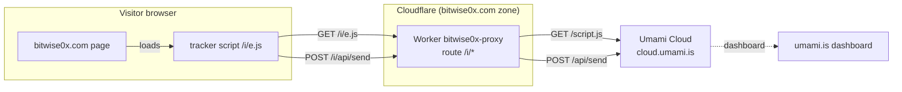
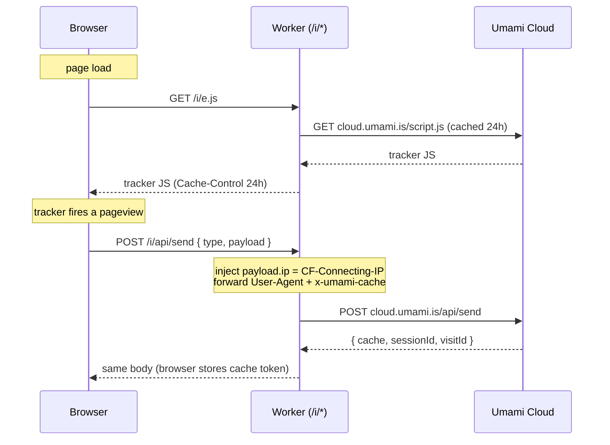
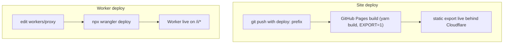

# Umami analytics via Cloudflare Worker

Analytics on bitwise0x.com run on [Umami](https://umami.is) Cloud, but the tracker
script and its beacon are served first-party through a Cloudflare Worker instead
of loading directly from `cloud.umami.is`. This document is the current state of
that integration as of 2026-09-15.

## Why first-party

Umami Cloud serves its tracker from `cloud.umami.is` and receives beacons at
`cloud.umami.is/api/send`. Both hostnames are on the blocklists (EasyPrivacy and
similar) that uBlock Origin, Brave, and Pi-hole enforce. The match is purely on
hostname; it says nothing about Umami, which is cookieless and does not
fingerprint. For a developer audience, a large share of visitors run one of
those blockers, so the third-party endpoint never loads and the visit never
reaches the dashboard.

Serving the same script and beacon from the site's own origin under an opaque
path (`/i/*`) removes the third-party hostname the lists key on. The request now
looks like any other first-party asset, so it is not stripped. This is the more
authentic path than a fragile client-side workaround: the browser talks only to
`bitwise0x.com`, and the Worker relays to Umami server-side.

## Moving parts



Three pieces:

1. **The site** renders a `<script>` tag pointing at `/i/e.js` with
   `data-host-url="https://bitwise0x.com/i"`. Wired through pliny's `Analytics`
   component from `siteMetadata.js`.
2. **The Worker** (`workers/proxy`) answers `/i/e.js` and `/i/api/send`,
   forwarding both to Umami Cloud and fixing up the beacon so geolocation works.
3. **Umami Cloud** stores the data and serves the dashboard at `umami.is`.

## Request flow



The beacon path is `/i/api/send`, not `/i/send`. The tracker builds its beacon
URL by appending `/api/send` to whatever `data-host-url` is set to. With
`data-host-url = https://bitwise0x.com/i`, that resolves to
`https://bitwise0x.com/i/api/send`. The Worker route must match exactly, or
every beacon 404s silently. See [Gotchas](#gotchas).

## The Worker

Source: [`workers/proxy/src/index.js`](../workers/proxy/src/index.js). Two
routes, everything else 404s.

### Serving the tracker

```js
async function proxyScript() {
  const upstream = await fetch(SCRIPT_UPSTREAM, {
    cf: { cacheTtl: SCRIPT_CACHE_SECONDS, cacheEverything: true },
  })
  if (!upstream.ok) return new Response('Upstream error', { status: 502 })

  const headers = new Headers()
  headers.set('Content-Type', 'application/javascript; charset=utf-8')
  headers.set('Cache-Control', `public, max-age=${SCRIPT_CACHE_SECONDS}`)
  return new Response(upstream.body, { status: 200, headers })
}
```

The script is cached at Cloudflare's edge for 24 hours (`cacheEverything`), so
most `/i/e.js` hits never reach Umami.

### Relaying the beacon

```js
async function proxySend(request) {
  const body = await withClientIp(request)

  const headers = new Headers()
  headers.set('Content-Type', 'application/json')
  const userAgent = request.headers.get('User-Agent')
  if (userAgent) headers.set('User-Agent', userAgent)
  const cache = request.headers.get('x-umami-cache')
  if (cache) headers.set('x-umami-cache', cache)

  const upstream = await fetch(SEND_UPSTREAM, { method: 'POST', headers, body })
  return new Response(upstream.body, {
    status: upstream.status,
    headers: { 'Content-Type': upstream.headers.get('Content-Type') || 'text/plain' },
  })
}
```

Three things are forwarded deliberately:

- **User-Agent**: Umami parses device, browser, and OS from it server-side.
  Without it every hit records as unknown.
- **x-umami-cache**: the session token Umami issued on the previous beacon.
  Forwarding it lets Umami skip re-resolving the session on every hit.
- **payload.ip**: the visitor's real IP, injected into the beacon body (below).

### Geolocation fix

```js
async function withClientIp(request) {
  const raw = await request.text()
  const clientIp = request.headers.get('CF-Connecting-IP')
  if (!clientIp) return raw

  let body
  try {
    body = JSON.parse(raw)
  } catch {
    return raw
  }
  if (!body || typeof body.payload !== 'object' || body.payload === null) return raw

  body.payload.ip = clientIp
  return JSON.stringify(body)
}
```

Umami Cloud sits behind Cloudflare too. When the Worker relays a beacon, Umami's
own edge stamps `cf-connecting-ip` with the Worker's egress address, and Umami
ranks that header above `X-Forwarded-For`. Forwarding the visitor IP as a header
therefore never works: every visitor collapses to a single location. Umami trusts
`payload.ip` in the beacon body over any header and geolocates it from its own
database, so the Worker writes `CF-Connecting-IP` into `payload.ip`. The parse is
defensive: a malformed or payload-less body is passed through untouched rather
than dropped.

## Configuration

### wrangler.toml

```toml
name = "bitwise0x-proxy"
main = "src/index.js"
compatibility_date = "2025-01-01"

routes = [
  { pattern = "bitwise0x.com/i/*", zone_name = "bitwise0x.com" }
]
```

The route binds `bitwise0x.com/i/*` to the Worker. The zone must be active in the
Cloudflare account, which it is, since the site already proxies through
Cloudflare.

### Site config

`data/siteMetadata.js` feeds pliny's `Analytics` component:

```js
umamiAnalytics: {
  src: process.env.NEXT_UMAMI_SRC || 'https://cloud.umami.is/script.js',
  umamiWebsiteId: process.env.NEXT_UMAMI_ID,
  umamiHostUrl: process.env.NEXT_UMAMI_HOST_URL,
},
```

pliny maps `umamiHostUrl` to `data-host-url` and `umamiWebsiteId` to
`data-website-id`, then renders the script tag. When the env vars are unset (local
dev), `src` falls back to the cloud endpoint and `umamiHostUrl` is undefined, so
the tracker talks to `cloud.umami.is` directly and no Worker is involved.

### Environment variables

Set as GitHub Actions repository **variables** (not secrets; none are sensitive):

| Variable              | Value                          | Purpose                        |
| --------------------- | ------------------------------ | ------------------------------ |
| `NEXT_UMAMI_ID`       | `23e367e0-...-4b2b41c8acc0`    | Umami website ID               |
| `NEXT_UMAMI_SRC`      | `https://bitwise0x.com/i/e.js` | first-party tracker script URL |
| `NEXT_UMAMI_HOST_URL` | `https://bitwise0x.com/i`      | first-party beacon base        |

CI passes them into the build in `.github/workflows/pages.yml`:

```yaml
- run: yarn build
  env:
    EXPORT: 1
    NEXT_UMAMI_ID: ${{ vars.NEXT_UMAMI_ID }}
    NEXT_UMAMI_SRC: ${{ vars.NEXT_UMAMI_SRC }}
    NEXT_UMAMI_HOST_URL: ${{ vars.NEXT_UMAMI_HOST_URL }}
```

The Cloudflare API token lives outside the repo, in the `CLOUDFLARE_API_TOKEN`
environment variable, used by wrangler at deploy time. It is never committed.

## Deploy

The site and the Worker deploy independently. They are not coupled.



**The GitHub Pages CI does not deploy the Worker.** It only builds and publishes
the static site. Worker changes go live only by running, from `workers/proxy`:

```sh
cd workers/proxy
npx wrangler login          # or set CLOUDFLARE_API_TOKEN
npx wrangler deploy
```

The site rebuilds only when the pushed commit message contains `deploy:`. Other
prefixes push to the repo but never trigger a Pages build, so a `siteMetadata.js`
change under a `fix:` commit will not go live.

## Verification

No Umami API token is stored locally, so dashboard reads are manual. Everything
below is checkable from the command line.

**Tracker served:**

```sh
curl -s -o /dev/null -w "%{http_code} %{size_download}\n" https://bitwise0x.com/i/e.js
# expect: 200 4717
```

**Beacon accepted** (browser-like User-Agent required, or Umami's bot filter
rejects it with `{"beep":"boop"}`):

```sh
curl -s -X POST https://bitwise0x.com/i/api/send \
  -H 'Content-Type: application/json' \
  -H 'User-Agent: Mozilla/5.0 (Macintosh; Intel Mac OS X 10_15_7) Chrome/128.0.0.0 Safari/537.36' \
  -d '{"type":"event","payload":{"website":"23e367e0-635e-4f0e-a5ab-4b2b41c8acc0","hostname":"bitwise0x.com","url":"/"}}'
# expect: {"cache":"...","sessionId":"...","visitId":"..."}
```

A `{"cache":...}` response means Umami accepted the event and opened a session.

**Geolocation working** (does the injected `payload.ip` reach Umami as the real
IP): send one beacon through the Worker and one straight to Umami Cloud with the
same User-Agent, within the same minute. Umami derives `sessionId` from the
client IP, so matching IDs prove the Worker's `payload.ip` equals the real client
IP.

```sh
UA='Mozilla/5.0 (Macintosh; Intel Mac OS X 10_15_7) Chrome/128.0.0.0 Safari/537.36'
BODY='{"type":"event","payload":{"website":"23e367e0-635e-4f0e-a5ab-4b2b41c8acc0","hostname":"bitwise0x.com","url":"/"}}'
curl -s -X POST https://bitwise0x.com/i/api/send -H "User-Agent: $UA" -H 'Content-Type: application/json' -d "$BODY"
curl -s -X POST https://cloud.umami.is/api/send  -H "User-Agent: $UA" -H 'Content-Type: application/json' -d "$BODY"
# expect: identical sessionId in both responses
```

The final confirmation, that the city and country actually render, is only
visible in the Umami dashboard Realtime view.

## Gotchas

These three each cost real debugging time and are documented here so they do not
recur.

1. **Beacon path is `/i/api/send`, not `/i/send`.** The tracker appends
   `/api/send` to `data-host-url`. The Worker originally routed `/i/send`, so
   every beacon 404ed for four days with no error surfaced anywhere. The route
   pattern in the Worker must match `data-host-url` plus `/api/send` exactly.

2. **Geolocation needs `payload.ip`, not a forwarded header.** Because Umami
   Cloud is itself behind Cloudflare, a forwarded `X-Forwarded-For` (or
   `CF-Connecting-IP`) is overridden by Umami's own edge and every visitor
   collapses to one location. Only writing the IP into the beacon body works.

3. **The Worker is not deployed by CI.** It is deployed by `wrangler deploy`
   only. Editing `workers/proxy` and pushing does nothing to the live Worker.

## What is tracked

### Automatic on every pageview

Umami records these with no extra code, on every pageview beacon. This is the
bulk of "who visited and where from":

| Dimension             | Source                          | Notes                                  |
| --------------------- | ------------------------------- | -------------------------------------- |
| Country, region, city | visitor IP (`payload.ip`)       | works because of the geolocation fix   |
| Referrer              | `document.referrer`             | the site the visitor came from         |
| UTM campaign params   | URL query (`utm_source` etc.)   | see [Acquisition](#acquisition)        |
| Browser, OS, device   | User-Agent (parsed server-side) | needs the forwarded UA                 |
| Screen size           | tracker reads `screen`          | desktop vs. laptop vs. mobile          |
| Language              | `navigator.language`            |                                        |
| Pages and entry page  | URL path                        | which pages a visit hit, and its first |

### Script configuration

Set in `data/siteMetadata.js` under `umamiAnalytics`. pliny spreads these props
and maps any `dataFoo` key to a `data-foo` attribute on the script tag (pliny's
`Analytics` component spreads `umamiAnalytics` into its `Umami` component).

```js
umamiAnalytics: {
  src: process.env.NEXT_UMAMI_SRC || 'https://cloud.umami.is/script.js',
  umamiWebsiteId: process.env.NEXT_UMAMI_ID,
  umamiHostUrl: process.env.NEXT_UMAMI_HOST_URL,
  dataPerformance: 'true',   // Core Web Vitals per visitor
  dataExcludeHash: 'true',   // do not count #anchor navigations as pageviews
},
```

Two flags were **deliberately left off**:

- `data-do-not-track`: honoring browser DNT drops visitors from the data. The
  goal here is maximum visibility, so it stays off.
- `data-exclude-search`: this would strip UTM params from the URL, which is
  exactly the acquisition data we want. Off.

### Custom events

Instrumented with `data-umami-event` attributes (no JS API). Umami's tracker
uses `closest()` to find the attribute on the clicked element or any ancestor, so
the attribute can sit on a wrapper. Event names are capped at 50 characters.

| Event                | Where                                   | Properties       |
| -------------------- | --------------------------------------- | ---------------- |
| `outbound-click`     | `components/Link.tsx` (external branch) | `url`            |
| `share-x`            | `components/ShareLinks.tsx`             |                  |
| `share-bluesky`      | `components/ShareLinks.tsx`             |                  |
| `share-native`       | `components/ShareLinks.tsx`             |                  |
| `share-copy-link`    | `components/ShareLinks.tsx`             |                  |
| `load-comments`      | `components/Comments.tsx`               | `slug`           |
| `search-open`        | `components/SearchButton.tsx`           |                  |
| `project-visit`      | `components/ProjectsList.tsx`           | `project`, `url` |
| `project-learn-more` | `components/ProjectsList.tsx`           | `project`        |
| `social-click`       | `components/social-icons/index.tsx`     | `platform`       |

`outbound-click` lives on the external-link branch of `Link.tsx`, which every
external link in the site funnels through, so it covers far more than the project
links. Project links pass their own `data-umami-event` through `Link`'s prop
spread, overriding the default `outbound-click` with the more specific
`project-*` name while keeping the `url` property.

### Event quota

The site is on the Umami Cloud **Hobby** plan: 100,000 events per month, 1
website, 6-month retention. Two things to keep in mind against that ceiling:

- `data-performance` adds roughly one extra beacon per pageview (a second event
  carrying the Web Vitals), so enabling it roughly doubles pageview event count.
- Each custom event counts as one event.

For a persona site this is very unlikely to approach 100K. If the dashboard ever
shows the monthly count climbing near the cap, the first lever is turning off
`data-performance` (revert the `dataPerformance` line), which halves pageview
cost at the price of losing Web Vitals.

## Acquisition

"Where users came from" comes from two automatic fields: the **referrer** and
**UTM parameters**.

- **Referrer** is set by the browser when a visitor clicks a link from another
  site. Umami groups referrers on the dashboard.
- **UTM parameters** (`utm_source`, `utm_medium`, `utm_campaign`, `utm_term`,
  `utm_content`) are read from the landing URL's query string and shown under the
  dashboard's UTM report.

The practical catch: links shared in Slack, Discord, email clients, and most
native mobile apps arrive with **no referrer**, so without a tag they show up as
"Direct" and the source is lost.

The share buttons handle this automatically. `components/ShareLinks.tsx` appends a
UTM tag to every URL it shares, so the channel is attributed without any manual
step:

| Button    | `utm_source` | `utm_medium` |
| --------- | ------------ | ------------ |
| X         | `x`          | `social`     |
| Bluesky   | `bluesky`    | `social`     |
| Share     | `native`     | `share`      |
| Copy link | `copy`       | `share`      |

`utm_campaign` is the page slug (the last path segment, or `home` for the root),
so shares of different pages stay separated in the UTM report. Example produced by
the X button on a post:

```
https://bitwise0x.com/blog/some-post?utm_source=x&utm_medium=social&utm_campaign=some-post
```

Links posted **by hand** elsewhere (a comment, a newsletter, a talk slide) still
need a tag added manually to be attributed; only the on-page share buttons tag
themselves.

## Verifying the tracking after deploy

The config attributes and event attributes render into the static HTML, so they
are greppable in the built `out/` directory and on the live site:

```sh
# in the built output
grep -rl 'data-performance' out | head
grep -rl 'data-umami-event="outbound-click"' out | head

# on the live site (after a deploy: commit ships)
curl -s https://bitwise0x.com/ | grep -oE 'data-performance[^,}]*|data-umami-event="search-open"'
```

Live confirmation that events land is only visible on the Umami dashboard: click
an instrumented element and watch it appear under Events in Realtime.
